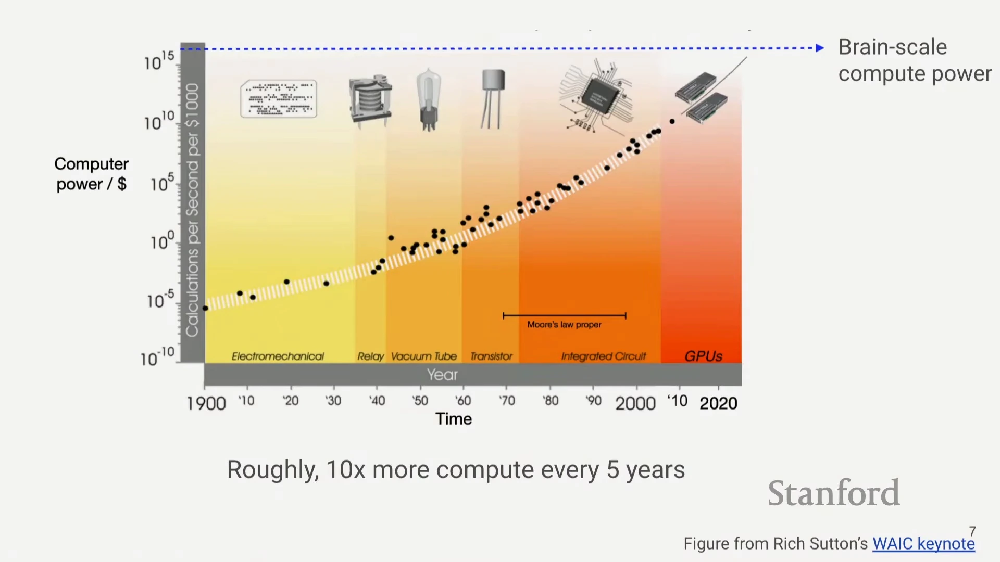
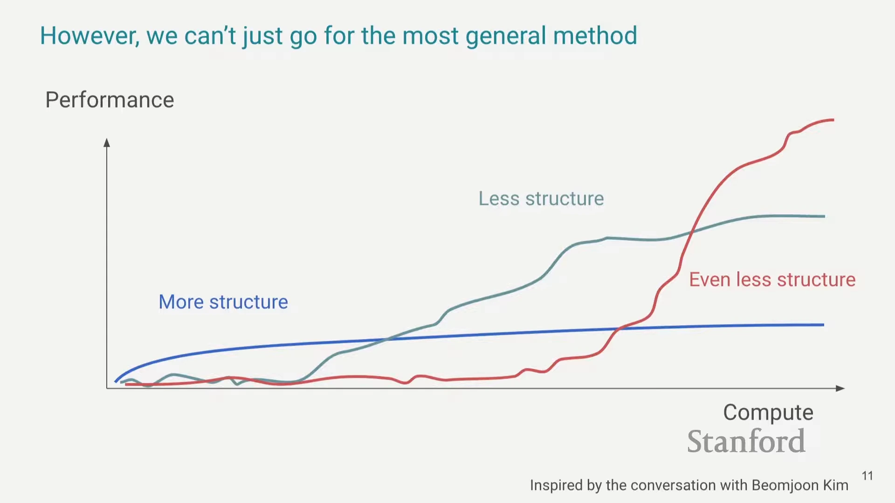
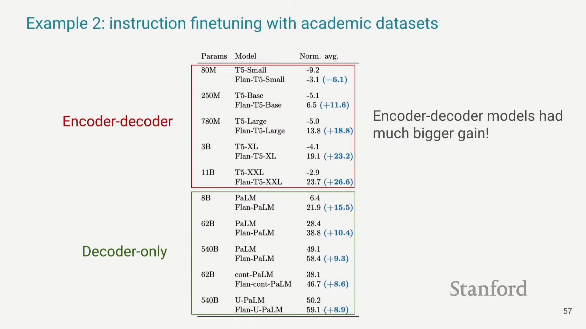
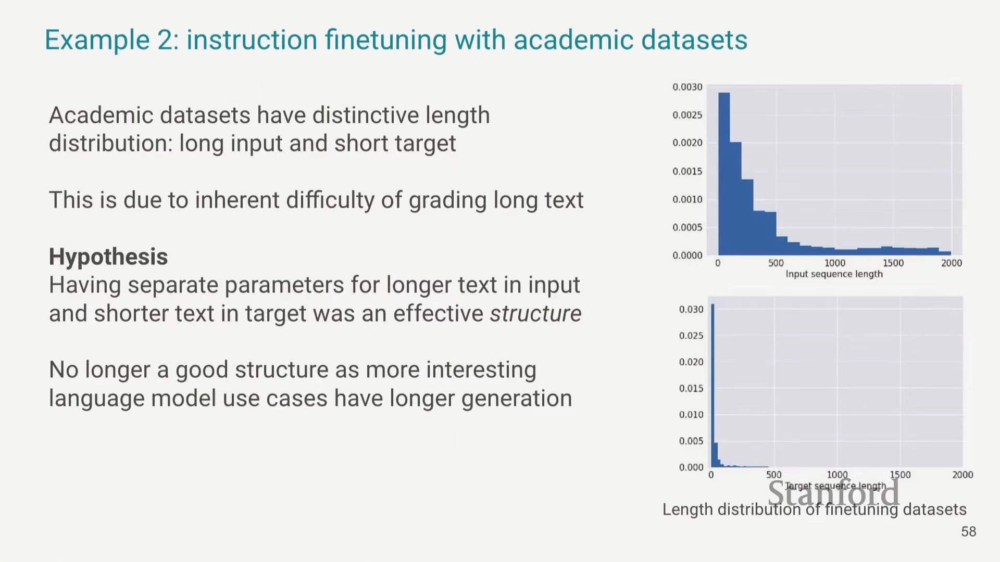
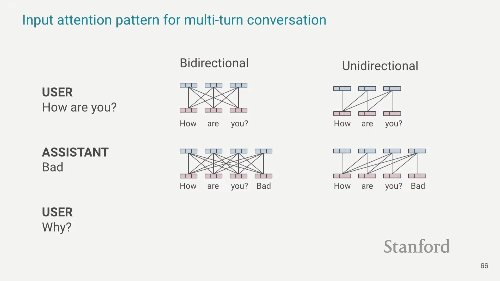

+++
title = "Hyung Won Chung：长期更好的 AI 方法，现在往往看起来更差"
date = "2026-10-11T19:38:26+08:00"
draft = false
description = "整理自 Hyung Won Chung 的 Stanford CS25 讲座：算力不足时加入的结构，为什么需要在规模扩大后重新检查？从 Flan-T5 到多轮聊天，理解添加与移除结构的取舍。"
tags = ["AI", "Transformer", "Scaling"]
+++

2024 年四月十一日，OpenAI 的 Hyung Won Chung 在 Stanford CS25 讲了算力成本、结构取舍，以及 Transformer 从翻译走向通用语言模型的变化。

本文按话题整理这次讲座，保留他的判断与案例。Chung 在开场说明，他想分享自己的思考方式，这些观点带有很强的个人色彩，并不声称一定正确。

## 追不上新进展时，如何研究变化？

Chung 看到许多人花大量时间追赶最新进展。无论有多少年经验，每周出现的新东西都让人难以跟上。旧方法被认为已经过时，很少再得到同样的注意。

他觉得仍然需要回头看：“当变化快到超出我们追赶的能力时，我们需要研究变化本身。”把过去的方法与今天的方法放在一起，弄清楚怎样走到这里，再思考接下来会往哪里走。

他提出先找出变化背后的主导驱动力，充分理解它，再沿着它推演未来的轨迹。一次变化通常有许多推动因素，他想获得的是方向感，不要求把每一个因素都算进去。

他把预测的范围限定在狭窄的科学领域。一般意义上的未来很难预测，涉及的主导因素太多，它们之间的相互作用又增加了复杂性。缩小范围，才可能找到值得推演的驱动力。

预测也不必每次都准确。他举例说，假如准确率从百分之一提高到百分之十，做一百次预测，就可能有十次正确。其中一次如果特别准确，产生的影响可能超过其他所有预测。

面对新 Agent、新模态和新榜单，人很容易觉得 AI 的未来完全无法判断。他认为，许多看似分散的变化背后，有一个足够强的共同驱动力，可以帮助我们理解它们。

## 算力变便宜，如何改变方法选择？

聊到这个驱动力，他引用 Rich Sutton 的一张图：花一百美元能买到多少计算能力，这个数字在一百多年的时间里持续上升。他说，同样的钱，每五年能买到约十倍的算力。

图：讲座引用的算力成本趋势，纵轴采用对数刻度。截图来自原视频 [08:10](https://www.youtube.com/watch?v=orDKvo8h71o&t=490s)，幻灯片注明原图来自 Rich Sutton 的 WAIC 演讲。

他把算力成本的指数下降，以及随之而来的规模扩大，视为 AI 研究的主导驱动力。“算力变便宜的速度，比我们成为更好的研究者的速度还快。”他的建议是尽可能利用这个趋势。

研究者的工作是教机器思考。一种常见做法，是先建立一个关于人类如何思考的模型，再把它写进数学模型里。可我们真的理解思考在底层怎样发生吗？他的回答是：“我不觉得我们理解。我完全不知道发生了什么。”

按他的理解，这些人为加入的结构，短期可以提供捷径，让方法更容易奏效，却也限制了机器的自由度。继续扩大规模时，当初的结构可能成为瓶颈，而研究者事先并不知道它会怎样限制模型。

他拿 2000 年的模型与当时的模型比较，认为早期模型在技术上复杂得多。方法逐渐变得通用，也变得更简单，从技术角度看，进入 AI 研究反而更容易了。

他把《苦涩的教训》称为 AI 领域最重要的文章，并用自己的措辞概括：过去七十年的研究，不断发展更通用、建模假设更弱的方法，再加入更多数据和算力。

在他看来，理解这条历史，比追逐每一种新技巧更有帮助。算力成本下降并非唯一的推动因素，但足够强，值得拿它来审视研究中的选择。

## 为什么不能一开始就去掉所有结构？

Chung 用几条示意曲线比较不同方法。结构更多、假设更多的方法，在算力较少时往往表现更好。随着算力增加，它可能因为某个结构的限制，较早进入平台期。

给模型更多自由的方法，起初可能根本不好用。继续投入算力以后，它才开始奏效，随后取得更好的表现。他把这种方法称为更能随着规模扩大而改进的方法。

那是不是从第一天就应该选结构最少、自由度最大的方法？他说：“答案显然是否定的。”还可以有一种更通用的方法，但它需要更多算力，远超当前条件，眼下仍然无法工作。

图：蓝、灰、红三条曲线分别表示结构逐渐减少的方法。红线需要更多算力才开始奏效。这是讲者用于解释取舍的示意图，没有给出实验数据；截图来自 [12:20](https://www.youtube.com/watch?v=orDKvo8h71o&t=740s)。

选择取决于我们处在什么位置，不能无限等待最通用的方法。给定算力、数据、算法和架构，总有一些适合当前条件的结构，帮助研究取得进展。

“但我们必须记住，加入某些结构，是因为我们没有足够的算力，所以之后需要把它们移除。”有了更多算力、更好的算法以后，需要重新检查这些结构是否妨碍继续扩大规模。

他所说的取舍，同时涉及现在和以后。当前可用的方法值得选择，但当初选择它的条件会改变。那些条件改变以后，原先有用的假设未必仍然适合。

## 论文激励为什么偏向添加结构？

沿着这个问题，Chung 谈到研究共同体的习惯：大家很擅长加入结构。“你加一个漂亮的东西，就能得到一篇论文。但把它移除，通常并不能给你带来多少回报。”

他认为，这种激励使得结构容易被加入，却不容易被拿掉。某个阶段帮助模型前进的捷径，就这样保留下来，即使后来有了更多算力，或者有了更好的算法。

他希望研究者多做一些移除结构的工作，并提出一个判断：“长期更好的方法，现在几乎必然看起来更差。”这也是他从《苦涩的教训》中读出的另一层含义。

他把这个判断与学习方法联系起来：模型有更多自由，可以自己选择怎样学习，起初可能更混乱，表现也更差。等到方法开始奏效，更多算力才可能让它进一步变好。

## Transformer 的输入输出，为什么逐渐共享参数？

聊到具体架构，Chung 回看了 2017 年的 Transformer。当时机器翻译是重要任务，输入是英语，输出是德语。编码器处理英语，解码器处理德语，两边使用不同参数，很自然。

这种设计包含一个假设：输入与目标足够不同，值得分别用参数处理。对只需要学翻译的模型，这个假设有用。通用语言模型需要学习的知识，却同时存在于英语、德语等语言里。

他说，我们希望把这些知识结合起来，用不同参数把它们分开表示，在他看来不自然。GPT 类模型使用的 decoder-only 架构，则让同一套参数处理输入与目标。

它也能用于监督学习：把输入和目标拼接起来，交给同一个模型处理。输入与输出之间的联系，以及各自序列内部的联系，都由同一种自注意力机制承担。

Chung 回忆在 Google 做指令微调的经历。他们花了约百分之九十九的时间优化 PaLM，最后只花约三天处理 T5，但 T5 从微调中获得的性能增益大得多。

图：表中蓝色括号标出微调带来的增益，比较时应区分增益与最终分数。截图来自 [29:15](https://www.youtube.com/watch?v=orDKvo8h71o&t=1755s)。

论文发表以后，他继续追问原因。他的假设与长度有关：当时使用的一千八百三十二个学术任务，常常有很长的输入，却只有很短的目标，输入和输出的分布很不一样。

这些任务把输入做长，以增加难度，但目标很难做得同样长。他认为，分别处理输入和输出的架构，恰好适合这样的数据。这是他对结果的解释，而非讲座中给出的因果验证。

图：上图为输入长度分布，下图为目标长度分布。左侧以“Hypothesis”标明，独立参数适合这种长度差异是他的假设。截图来自 [29:55](https://www.youtube.com/watch?v=orDKvo8h71o&t=1795s)。

现代用途里，长输出反而很有吸引力。到了多轮聊天，本轮输出又会成为下一轮输入。他问：“如果下一轮它就变成同一个东西，考虑使用不同参数还有意义吗？”

## 多轮聊天为什么适合单向注意力？

Chung 又回看双向注意力。在这种机制下，输入中的每个词元都能参考前后的词元。他认为，2018 年的问答任务很难，多一个有效技巧就可能带来很大的提升。

规模扩大以后，这种额外结构还有多大作用？他说，他们在 Flan-2 中尝试过双向和单向微调，没有看到很大的区别；他也明确说明，这只是个人经验。

他接着举了聊天的例子：“你怎么样？”“不好。”“为什么？”使用双向输入注意力时，新内容加入以后，旧词元也能参考它，之前的表示需要重新计算。

单向注意力只参考当前及之前的词元，旧词元的表示不依赖后来加入的内容。这样，已经处理过的部分可以缓存，下一轮只处理新增部分，多轮对话时差别就会很大。

图：左侧双向注意力在加入“Bad”后改变旧词元的连接；右侧单向注意力保留旧词元的依赖关系，因而可以复用此前计算的表示。截图来自 [34:50](https://www.youtube.com/watch?v=orDKvo8h71o&t=2090s)。

按他的判断，双向注意力曾经解决的困难，很大程度上已经由规模扩大解决；在多轮聊天中，它又带来重算的工程问题，所以需要重新考虑是否保留。

讲座最后，他把问题留给研究者：自己的问题里，有哪些假设需要重新检查？它们还相关吗？如果不相关，为什么？能不能用更通用的方法，再把规模扩大？

本文整理自 Stanford CS25 讲座《Stanford CS25: V4 I Hyung Won Chung of OpenAI》，讲者为 Hyung Won Chung。

[原视频与英文字幕](https://www.youtube.com/watch?v=orDKvo8h71o)，讲座日期为 2024 年四月十一日，视频发布于同年六月十一日。
