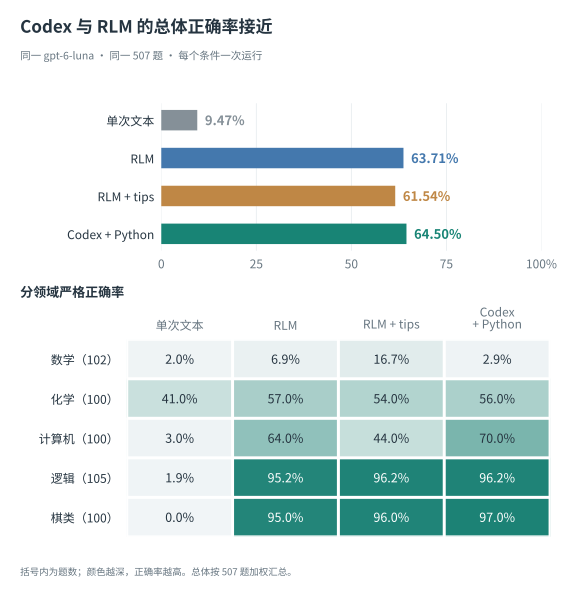
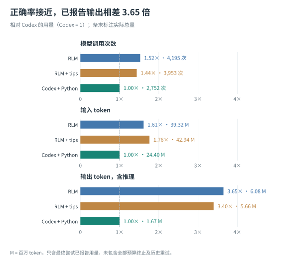
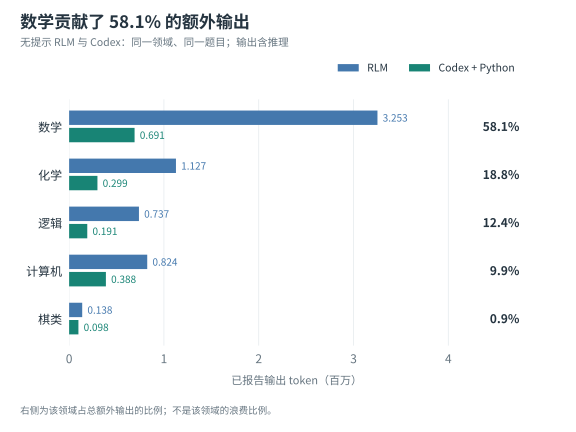
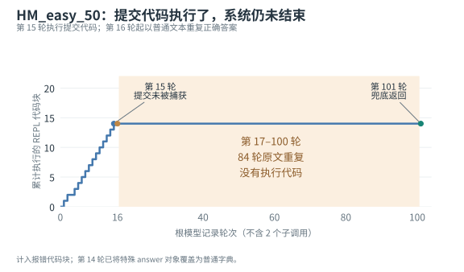

+++
title = "RLM vs. Codex：一次 LongCoT-mini 对照实验"
date = "2026-10-09T23:34:00+08:00"
draft = false
description = "同一个 gpt-6-luna，在 507 道 LongCoT-mini 题上，RLM 的正确率为 63.71%，只提供离线 Python 的 Codex 为 64.50%，前者的已报告输出 token 是后者的 3.65 倍。结合机制、提示调优和执行轨迹，讨论 RLM 相对 Codex 的额外收益。"
tags = ["AI", "Agent", "LLM", "RLM", "Codex", "Benchmark"]
+++

最近我在了解 [RLM（Recursive Language Models）](https://arxiv.org/abs/2512.24601)，这篇论文已被 NeurIPS 2026 录用（[作者介绍](https://alexzhang13.github.io/blog/2025/rlm/)）。我想弄清楚它究竟是 hype，还是确实带来了值得采用的东西。RLM 强调外置上下文、程序化处理和递归调用；读这些设计时，我首先想到的是自己平时使用的 Codex：这些能力，它是不是已经有了？

**我目前的判断是，RLM 也是一种 harness。Codex 的工具、subagent，以及通过 CLI 或 SDK 编写的调度脚本，可以表达同类工作流。我还没有看到一种必须采用 RLM 才能获得的基本操作。**

这里的 harness，指的是给模型提供工具、管理上下文和状态、组织调用并控制执行的软件层。Codex 是我日常使用的通用 coding harness，RLM 的价值也应当与它比较：同一个模型，换成 RLM 之后，是否能解决更多任务，消耗更少计算，或者交付得更可靠？一个清晰的接口，以及围绕它开展的训练，都可能有价值，但这些价值需要通过对照来检验。

[Alex Zhang 关于 RLM 与 LongCoT 的博客](https://alexzhang13.github.io/blog/2026/longcot-rlm/)提供了一个很好的切入点。我复现了其中的任务，又补上 Codex 对照。结果是，只留下离线 Python 的 Codex，已经取得了与 RLM 相近的正确率；RLM 的已报告输出 token 却是它的 3.65 倍。

所以，本文比较 RLM 与 Codex 的能力、任务收益和消耗，分析这份提升的来源。Codex 的结果让我认为，许多看上去属于 RLM 的收益，首先属于模型使用工具、执行程序和利用反馈的能力。

## RLM 的操作，Codex 能怎样实现？

RLM 把输入保存在外部运行环境中，让根模型通过 Python REPL 读取、切分和处理它。模型可以把中间结果留在变量里，在代码中调用子模型，再把返回结果组合起来。子任务也可以拥有自己的 REPL，继续执行和委托。

这个设计把上下文访问和一部分控制逻辑交给了程序。根模型不必一次读完所有输入，也不必把所有中间状态保存在生成的文字里。对于超长输入和大量语义子任务，这是一种合理的组织方式。

Codex 的文件访问、执行工具与子任务接口，也能组合出这些操作：

| RLM 的机制 | Codex 可以采用的方式 |
|---|---|
| 输入保存在 REPL 变量中 | 输入保存为文件，按需读取、搜索和切片 |
| 中间状态保存在运行时 | Python 工具中的数据结构、文件或 checkpoint |
| 调用普通子模型 | 子 agent 或独立 Codex 会话 |
| 子任务拥有上下文与工具 | 配置相应工具的 Codex subagent |
| 用代码组织批量调用与递归 | 脚本通过 Codex CLI 或 SDK 调度多个会话 |
| 大段答案从变量返回 | 写入结果文件，由调用方读取 |

Codex 的 subagent 提供新的模型上下文，也可以带着工具独立工作。程序化调度则可以通过 [`codex exec`](https://developers.openai.com/codex/noninteractive) 或 [Codex SDK](https://developers.openai.com/codex/sdk) 实现：脚本生成子任务输入、启动会话、收集结果，再用代码处理循环、并发、分支和汇总。需要继续分解时，调度程序可以生成后续任务。

这与我之前在[从 ReAct 到 Dynamic Workflows](https://lqhl.me/blog/from-react-to-dynamic-workflows)里讨论的思路相同：模型编写调度程序，运行时持有控制流。这里比较的是 Codex 配合调用接口和脚本能够表达的工作流，具体工具权限与递归深度由配置决定。

因此，能力覆盖的论点不只依赖“Codex 也有 subagent”。外置输入、持久状态、独立子任务和程序化调度，都可以在 Codex 周围组合起来。RLM 把它们组织成一个明确的接口，可能让模型更容易使用，也可能更适合产生训练轨迹；Codex 则已经提供了实现这些行为的基础。

**在操作层面，我没有看到 RLM 相对 Codex 无法替代的能力。接下来要检验的是，在相同模型和任务上，这种组织方式是否带来了额外收益。**

## 给 LongCoT 补上 Codex 对照

[LongCoT](https://arxiv.org/abs/2604.14140)用数学、化学、计算机、逻辑和棋类任务，考察连续计算、图结构依赖和状态更新。前面一个值算错，可能影响后面的许多步骤；模型还需要按约定交付完整答案。

作者报告，GPT-5.2 的单次作答正确率为 38.7%，换成 RLM 后达到 50.6%，再加入解题提示（tips）后达到 65.6%。这支持一个重要观察：一种使用方式下的失败，不能直接代表模型完成任务的能力上限。

从单次文本到 RLM，已经同时加入了代码执行、外部状态与多轮反馈，RLM 的接口还支持子模型调用。这项比较还回答不了我最关心的问题：已经能执行代码、保存状态和修正错误的 Codex，会表现怎样？

我使用同一模型名 `gpt-6-luna`、同一冻结的 507 道 easy 题和同一确定性评分器，比较四个条件。Codex 保留内置基础指令，没有额外解题 tips；唯一可用工具是离线 Python，shell、联网和子 agent 都关闭。正常答错不重新抽样，预算终止按失败保留。

| 条件 | 严格正确率 | 正确题数 |
|---|---:|---:|
| 单次文本 | 9.47% | 48/507 |
| RLM | 63.71% | 323/507 |
| RLM + tips | 61.54% | 312/507 |
| Codex + 离线 Python | 64.50% | 327/507 |

[](./accuracy.svg)

> <a id="fig-1"></a>**图 1**：本地扩展复现的总体与分领域结果。总体按全部 507 题汇总，下方括号内为题数。每个条件只运行一次。点击图可查看原图。

Codex 比无提示 RLM 多答对 4 题。逐题比较，双方都对 299 题，Codex 独对 28 题，RLM 独对 24 题，双方都错 156 题。正确率差为 0.79 个百分点，配对 bootstrap 的 95% 区间是 −1.97 到 +3.55 个百分点，跨过了零。

我据此判断，本次没有检测到 RLM 相对 Codex 的准确率优势。这个小幅差值不足以宣布 Codex 稳定胜出；更有实际意义的是，**Codex 在解题时连子任务委托都没用，只靠离线 Python，就已经拿到了相近的总体成绩。**

架构上的能力比较与这里的实测结果，是两类互相补充的证据。前者说明 RLM 的工作流能用 Codex 的工具、子会话和脚本表达；后者说明，在这批任务上，Codex 的执行部分已经能获得主要收益。这不表示两者在所有任务上都有相同表现。

两套配置的系统指令、API、执行接口、计算库和隔离条件存在差异，所以这是完整系统的比较，无法把差值单独归因于递归。本地模型、实现和题集覆盖也与作者不同，属于扩展复现。具体设置见[文末说明](#reproduction-notes)。

## 长链条变成程序之后，收益是怎样产生的？

看成功轨迹，我最直观的感受是：模型主要在写程序、运行程序、修程序。

纯文本推理要求模型在生成过程中维持大量细节：当前状态是什么，前面用了哪个值，下一个分支是否满足约束。转成程序之后，变量保存精确状态，算法执行循环，断言检查约束。模型仍然需要理解题意、选择算法、调试程序和判断结果，只是不用把每一次状态更新都写成文字。

BlocksWorld 的一条轨迹很典型。模型起初把描述模板误读成实际实例，查看解析出的匹配项后修正读取方式，生成了 1832 步移动。随后，它从初始状态逐步重放这些移动，确认最终状态等于目标状态。让程序执行并检查这条长链，比在文字中维持上千次移动可靠得多。

HM 类型推导也是如此。模型实现 Algorithm W，修复表达式解析问题，再导出 831 项绑定记录和指定检查点。推导过程的中间状态保存在 Python 数据结构里。另一道棋子组合题，则通过枚举合法运动路径、检查每个时间点的碰撞，得到准确计数。

这三个例子都没有子模型调用。两个 RLM 条件合计有 635 个正确结果，其中 **486 个，即 76.54%，可确认没有调用子模型**。同一道题在两个条件下的成功分别计入；确认同时使用执行代码和调用用量，避免被日志中不完整的子调用字段误导。

多数成功直接发生在根模型的代码执行与反馈循环里。程序执行、保存状态、查看报错和重放验证，也正是 Codex 的解题方式。仅有 Python 的 Codex 取得相近成绩，与这些轨迹是一致的。

递归仍有成功例子：一个 Sokoban 任务由子 RLM 返回候选路径，根模型用模拟器验证后正确提交。但没有同题关闭递归的对照，而且模型自行选择何时委托，难题可能更容易触发子调用。因此，不能用有调用和无调用两组的正确率差，判断委托的因果效果。

我的判断是，LongCoT 上从单次文本到执行系统的大幅改善，首先展示了模型构造可执行解法的能力。原基准测量的是单次、无工具 CoT；工具系统的高分展示了另一种使用条件下能完成什么。要进一步把收益归给 RLM 的递归机制，需要在 Codex 对照的基础上，进一步隔离它的贡献。

## tips 的收益，不能全部记到 RLM 名下

作者最好的结果，还包含了一份根据 GPT-5.2 失败轨迹生成的提示。博客明确说，先查看 LongCoT 的失败轨迹，再让 Claude Code 编写 tips，随后重新运行基准。

| RLM 条件 | 作者的 GPT-5.2 配置 | 本地 Luna 配置 |
|---|---:|---:|
| 无额外 tips | 50.6% | 63.71% |
| 加 tips | 65.6% | 61.54% |
| 严格正确率变化 | +15.0 个百分点 | −2.17 个百分点 |

提示虽然对所有题相同，仍然带入了对基准的理解：怎样记录依赖关系，怎样处理循环约束，怎样提取父节点答案，何时独立复核，以及枚举范围应该控制在什么规模。例如公开提示写着：`usually 1..40 covers this dataset`。

从失败轨迹里提炼策略，是合理的工程工作。但 65.6% 应当归属于经过这种调优的完整系统。它包含执行环境、提示策略与模型能力的共同贡献，不能全部解释成递归带来的提升。

公平比较需要交代这份额外信息来自哪里。要论证泛化，就需要区分用于开发提示的题目与最终评测题，冻结提示后再测新题。博客没有交代这个划分。作者做过纯文本加 tips 的消融，仍然缺少获得同类工具与提示的 Codex 对照。

换到本地配置，这套提示的总体严格得分没有提高。不过，“tips 对 Luna 完全没用”也不符合轨迹：数学全对从 7/102 提高到 17/102，非终态的原文重复回答从 309 次降到 1 次。解题、协议遵守与最终交付，会受到不同影响。

尤其是 tips 组的 HM 任务，22 个失败中有 20 个答案内容完全匹配参考，只是交付了带单引号的 Python 字面量，而题目要求 JSON。这些失败应保留在严格分数里，却不能直接理解成推理退化。矩阵链题也常给出正确的最优括号表达式，却因标量乘法次数与参考 FLOPs 约定相差一倍而失分。

所以，我更愿意把这一观察写成：**针对一套失败轨迹调出的提示，收益依赖模型、接口与任务，不能默认迁移。** 两列结果来自不同模型和配置，也不能单独证明模型代际进步。

但无需这套解题 tips 的 Codex 已经达到 64.50%，确实说明本次模型在通用执行环境中，能够自行选择算法、编写程序和利用反馈。这个现象让我更看重模型本身的工具使用能力。随着这种能力增强，原来需要显式提示的策略，可能不再需要额外脚手架；本次实验能确认的是，它们已经不是取得相近总体成绩的前提。

## 相近的成绩，花了多少 token？

正确率接近之后，效率就成为采用一种 harness 的重要理由。本次无提示 RLM 与 Codex 的已报告用量如下：

| 指标 | 无提示 RLM | Codex |
|---|---:|---:|
| 模型调用 | 4,195 | 2,752 |
| 输入 token | 39,315,775 | 24,395,516 |
| 输出 token，含推理 | 6,078,147 | 1,666,753 |

[](./usage.svg)

> <a id="fig-2"></a>**图 2**：三个执行条件的调用和 token 总量。只覆盖最终尝试已报告用量；RLM 有 7 题、tips 组有 2 题缺失用量，历史基础设施重试未计入。输出包含推理 token，输入缓存没有同等明细，因此这些比例不能直接换算成美元费用比例。

RLM 的输出是 Codex 的 **3.65 倍**。总量可以拆成 **1.52 倍的调用次数 × 2.39 倍的平均每次输出**。它不仅调用更多，每次调用平均生成的内容和推理也更多。

另一个有意思的对照是，Codex 的输出甚至略低于单次文本条件的 170.7 万 token，却多答对了 279 题。这与轨迹中的现象一致：把长链条交给程序执行，可以增加实际完成的计算，同时不要求模型生成更多文字。

[](./output-by-domain.svg)

> <a id="fig-3"></a>**图 3**：无提示 RLM 与 Codex 在相同领域的已报告输出。右侧表示该领域占总额外输出的比例。数学贡献约 256.2 万额外输出 token，这不表示全部额外计算都是浪费。

数学用了 RLM 总输出的 53.5%，严格全对只有 7 题，贡献了相对 Codex 额外输出的 58.1%。没全对的数学题仍有 32 题获得部分奖励，投入并非毫无结果，但没有稳定转化为端到端成功。

如果一种专门组织方式以更多计算换来相近成绩，那么我需要知道额外计算完成了什么工作。逐轮轨迹让这个问题变得具体。

## 额外计算做了些什么？

### 已经算对，却没能结束

最明显的案例是 `HM_easy_50`。第 15 轮，模型已经执行了写入正确答案、设置 `answer["ready"] = True` 并打印答案的代码。代码没有报错，运行器却没有收到终止信号。第 16 轮开始，模型用普通文本回答，随后又有 84 轮原样重复，没有执行代码。

原因是第 14 轮的 `answer = {...}`。模型用这个变量保存求解结果，覆盖了运行器预置的特殊对象。特殊对象通过赋值回调通知系统结束，普通 Python 字典没有这项回调；后面即使设置 `ready = True`，也只是在字典里修改一个值。

这一问题可以用很短的代码复现：

```python
answer = {"q1": "Bool"}  # 覆盖了预置的特殊对象
answer["content"] = "CHECK"
answer["ready"] = True  # 普通字典不会发出终止通知
```

我用同一环境做了不调用模型的[最小复现](./check-answer-buffer.py)：不覆盖对象时，提交返回 `CHECK`；先覆盖成普通字典，再执行相同提交代码，没有报错，却没有返回终态答案。源码的 in-process 模式有重新包装对象的保护，本次使用的 subprocess 路径没有对应恢复。

[](./submission-stall.svg)

> <a id="fig-4"></a>**图 4**：`HM_easy_50` 的根模型逐轮行为。纵轴计入报错代码块。第 15 轮之后没有新增代码执行，100 轮根循环耗尽后，第 101 轮靠兜底回答结束；另有 2 个普通子调用未画入横轴。

这道题最终用了 103 次模型调用、461.7 万输入 token，耗时约 20 分钟。Codex 同题用了 7 次调用、9.2 万输入，约 81 秒。两者都答对。

同类停滞还出现在一道逻辑题和一道棋子组合题，三题都覆盖过特殊 `answer` 对象。它们合计贡献了 RLM 相对 Codex 额外输入的 **40.8%**。这个占比包括正常求解，不能当作修复后可节省的精确比例，但足以说明一个终止接口缺陷怎样放大输入长尾。

剔除这三题，输入比例从 1.61 降到 1.36，输出仍是 **3.60 倍**。因此，提交失效解释了相当一部分输入差距，却解释不了大部分输出差距。它有明确的工程修复路径，不能当成 RLM 不可避免的结构性成本。

### 反复委托，没有自动形成可靠验证

化学题 `easy1_19` 用了 21 个根轮次、12 次普通子查询，反复询问结构等价性、异原子计数、分子选择和溴化位置。子模型给出互相矛盾的解释，根模型继续询问，再改变假设。

最终 RLM 与 Codex 都答对，前者输出 75,236 token，后者为 3,059，相差 **24.6 倍**；调用次数为 33 对 6。部分核对确实纠正了错误，但更多意见没有自动形成独立证据，也没有产生可靠的停止条件。

数学题 `dag_easy_9` 则先整题委托，再改为分节点求解。一次子查询没有收到已知的节点 1 结果，直接指出缺少依赖。之后根模型不断重算与改口，最终超时：RLM 已报告 48 次调用、125,663 输出 token；Codex 同题为 18 次、9,110 输出，两者都失败。

这些案例显示，递归允许扩大计算，但任务切分、参数传递和结果验证仍然要做对。把工作交给更多模型，只有在这些工作带来进展时才有意义。

### context 外置了，内容仍然回到历史里

本地两个 RLM 条件的全部任务都打印过完整 `context`。代码、工具输出和过去的回答也进入后续请求，外部变量没有自动阻止内容返回模型历史。而本次题面最长只有 18497 字符，没有充分测试百万 token 输入的选择性读取优势。

用同一 tokenizer 估算日志可见文本，无 tips 根请求中约 78% 来自工具输出与过去的模型回答。它们包含必要信息，**78% 不是浪费比例**；但每多一轮，这些内容就会再次发送，停滞会进一步放大回放。

tips 本身也被反复带入根请求，仅这部分的可见分词代理量就约 645.7 万。提示减少了部分停滞，使总体输出下降约 6.9%，输入却增加约 9.2%。这里的文本估算不含消息封装、隐藏推理与未记录的子调用，只用于解释输入结构，不能与服务端用量混为一谈。

在可确认没有子调用的同一组 284 题上，RLM 输出仍是 Codex 的 **1.82 倍**。因此，高消耗还涉及根循环、提示、接口和历史管理，不能全部归于递归。现有遥测缺少逐请求的主／子调用与推理用量，尚不能精确分配每种机制的消耗占比。

## 递归能扩大计算，也增加了调度的责任

把前面的案例放在一起，我认为最有依据的批评是：RLM 增加了模型可用的计算与调度方式，也增加了对调度策略的要求。

分解任务需要构造自洽的输入，传递依赖和约束，再收集、解释、验证结果。传得少，可能漏掉条件；传得多，不同调用又会重复理解同一份信息。对能够写成一个程序的问题，过度分解还可能把廉价的确定性计算变成昂贵的模型调用。

本次默认提示要求模型 `act as an orchestrator, not a solver`，并鼓励委托。这是一项值得检验的策略选择。RLM 本身允许直接写程序和零子调用，因而不能把默认的委托倾向当作架构的强制要求。

验证也不会因为有多个模型自动变得可靠。重新求解来复核，会重复工作；再问同一个模型，错误可能相关；直接信任候选答案，则可能将错误传播到下游。代入、模拟、约束检查和独立方法都能帮助验证，系统还要学会什么时候停止。

[原论文](https://arxiv.org/html/2512.24601v3)附录 E.2 也记录了类似风险：一个 Qwen 案例已经把候选结果存进变量，却又重新生成五遍，最后没有返回保存的结果，反而生成了错误答案。更多计算没有稳定积累成更可靠的结果。

Codex 在启用子 agent 时，同样需要管理这些负担。上下文管理、可执行验证和停止策略，会影响两种 harness 的效果。RLM 把这些决策放进模型可操作的接口中，接口提供了自由度，可靠的使用策略仍需工程和训练来获得。

### Codex 的上下文继承可以减少交接损失

Codex 已经提供了一些交接选择。例如其[公开源码](https://github.com/openai/codex/blob/5fe4fc8f7cd16688b5c661d8cdb76e2a340b046d/codex-rs/core/src/tools/handlers/multi_agents/spawn.rs)支持可选的 `fork_context`，可以用完整父会话历史初始化子任务。子 agent 有机会直接看到题目、已知节点值和失败路径，减少依赖主模型临时撰写交接摘要造成的遗漏。

这正好对应 `dag_easy_9` 的失败模式。如果节点 1 的结果已经出现在父历史里，继承历史的子 agent 就有机会自行找到它，而不完全依赖父模型把它写进局部 prompt。一个带工具的 subagent 还可以读取保存的结果、执行程序并验证；本次普通 `llm_query` 只根据显式传入的文本作答，工具条件不同。

完整继承也有代价：历史更长，可能增加输入与注意力负担，还会带入父模型的错误假设。fork 通常提供创建时的历史快照，不会持续同步新结果，也不自动复制 Python 内存。更少重试与缓存可能改善净成本，实际效果仍需测量。

因此，父子调度、上下文继承与工具权限是可以组合的选择。RLM 也可以显式传递相关历史、共享数据引用或提供子 REPL。它们都属于 harness 怎样组织任务，不能按方法名称固定划分。

本次 Codex 关闭了 subagent，现有成绩与成本差距并不来自这些能力。它们说明的是，Codex 能用哪些方式缓解委托问题，以及启用完整子任务能力后可以表达什么工作流。

## 后训练的收益，也需要 Codex 对照

针对 RLM 接口做后训练，确实可能改善前面的问题：读取哪些内容，如何选择递归粒度，怎样传递依赖，何时直接写程序，以及怎样验证和停止。当前模型没有稳定使用这些操作，并不意味着它无法学会。

原论文已经报告了正面结果。第 4 节与附录 A 将 LongBenchPro 上的 RLM 轨迹蒸馏到 Qwen3-8B，报告其他长上下文任务的质量改善、成本下降，以及超过 3 倍的运行加速；还报告了 Qwen3-4B 在 MRCRv2 上的 RLVR 与长度泛化实验。作者在蒸馏前也专门修正了教师轨迹中的 `FINAL` 和 `FINAL_VAR` 协议错误。

这些结果说明，RLM 可以作为产生轨迹、训练上下文管理与程序化委托策略的接口。Codex 能表达同类工作流，与这些策略值得训练，可以同时成立。运行器缺陷仍需工程修复；只奖励最终正确，也不保证模型自动选择最省 token 的方法。

原论文在超长语义任务上还提供了更直接的递归消融。例如 GPT-5 在 OOLONG-Pairs 上，depth=0、1、3 的成绩分别为 43.9、58.0、76.0。这支持递归在特定任务上的收益。本次 LongCoT 实验没有充分覆盖这类任务，也没有评测论文的训练后模型。

要回答本文开头的问题，后训练也需要 Codex 对照。更有信息量的实验，是将同一个训练后模型经过合理接口适配，分别放到 RLM 和 Codex 中，在相同题集、工具权限与预算下比较。结果可以检验学到的读取与调度策略能否迁移到 Codex，也能检验 RLM 的专门接口是否仍有额外优势。

对于真正超长、需要逐段做语义判断的输入，协调开销可能换来原本很难完成的工作。对于已经能写成程序的问题，Codex 的执行环境就可能足够。这两类任务应分别比较质量、消耗与可靠性。

回到本次 LongCoT-mini，我没有看到 RLM 相对 Codex 的总体准确率优势，反而看到了更高的已报告消耗。两种 harness 的历史管理、调度与提交接口，仍然可能影响效率和交付，正如 [HarnessTax](https://lqhl.me/blog/harness-tax) 所讨论的，也正如本文的终止缺陷所展示的。

所以，我目前没有因为这份实验而换掉 Codex 的理由。RLM 的基本操作，可以用 Codex 的文件访问、执行工具、subagent 与调度脚本组合出来；这批任务的主要收益，Codex 仅用离线 Python 就已经拿到了。我更愿意把 RLM 看成一种组织和训练 agent 行为的方式。它是否值得单独采用，最终取决于能否相对 Codex 带来可测量的任务收益、效率或可靠性改善。

---

## 数据与复现说明 {#reproduction-notes}

**题集与评分。** 当前 easy 划分共有 507 题：数学 102、化学 100、计算机 100、逻辑 105、棋类 100。四个条件共 2028 项终态，使用同一确定性评分器；主文均保留原始严格分数，没有通过放宽 JSON 解析或修改 FLOPs 约定加分。题集与验证器冻结于 [LongCoT `fb964942`](https://github.com/LongHorizonReasoning/longcot/tree/fb9649423f15f5b0091f8e988b100596cac592ca)。

**模型与预算。** 模型接口名为 `gpt-6-luna`，使用 high reasoning，每次请求最大输出 125000 token。RLM 最多 100 个根轮次、最大深度 2，每题 1800 秒预算、worker 硬上限 1900 秒；Codex 最多 100 个主模型请求、1800 秒有效运行预算。Python 单元上限为 600 秒。单次文本条件只发起一次请求，两种执行配置都没有统一的整题输出 token 上限。

**实现与工具。** 本地 RLM 基于 [作者实现 `d04208af`](https://github.com/alexzhang13/rlm/tree/d04208afbad29ca675ab13478c40ee8bebc84bfe)，使用独立 IPython subprocess 和默认 orchestrator 提示。tips 从公开版本适配了提交接口及子调用说明，统一用于全部领域。Codex CLI 为 0.160.1，只保留离线 Python MCP，按本题 `/task/answer.txt` 评分；工具隔离禁止访问宿主主目录、参考答案、其他题目、网络和子进程。两者并非同一实现与隔离环境，早期 RLM 运行还有资源保护修订。

**失败与用量。** 正常答错不重抽样，基础设施错误归档后续跑，预算终止计零。token 总量只汇总最终尝试已报告用量，RLM 的用量覆盖为 500/507，tips 为 505/507，Codex 为 507/507。不包含全部历史重试，也没有完整的 RLM 缓存及逐请求推理明细。配对区间只描述对这批题重采样的不确定性，不代表独立重跑的波动；耗时还受 API 与运行并发影响。

**原作者材料的边界。** 博客称 500 题，冻结的[公开结果仓库](https://github.com/alexzhang13/longcot-mini-rlm-results/tree/fc71fd73bfec6ce70b429e3e892f6610c7a90bbb)只有 486 条轨迹，完整 cohort 无法恢复。公开轨迹的附加提示明确禁止子模型调用，记录的工具调用均为 Python；它们能展示执行收益，却不足以验证论文所描述的递归配置。CS 在当前验证器下还存在 HM 重评分差异，原修补实现未公开。这些缺口限制了独立复现，本地成绩不能当作原 GPT-5.2 结果被独立验证。

随文提供[汇总与逐轮行为数据](./analysis-data.json)、[绘图脚本](./plot.py)和[提交接口的最小复现](./check-answer-buffer.py)。汇总保留来源版本与 SHA-256，可复算本文图表；它不包含全部原始模型请求与完整轨迹。绘图使用 matplotlib 和 CJK 字体，无需模型调用。图片同时提供 SVG 与 PNG：[正确率](./accuracy.png)、[总体用量](./usage.png)、[领域输出](./output-by-domain.png)、[提交停滞](./submission-stall.png)。

延伸阅读：[RLM 论文（NeurIPS 2026）](https://arxiv.org/abs/2512.24601)、[作者对 RLM 的介绍](https://alexzhang13.github.io/blog/2025/rlm/)、[LongCoT 实验博客](https://alexzhang13.github.io/blog/2026/longcot-rlm/)、[LongCoT 论文](https://arxiv.org/abs/2604.14140)、[RLM 论文 v3](https://arxiv.org/html/2512.24601v3)、[Codex multi-agent 文档](https://developers.openai.com/codex/multi-agent)、[Codex 非交互模式](https://developers.openai.com/codex/noninteractive)、[Codex SDK](https://developers.openai.com/codex/sdk)。
